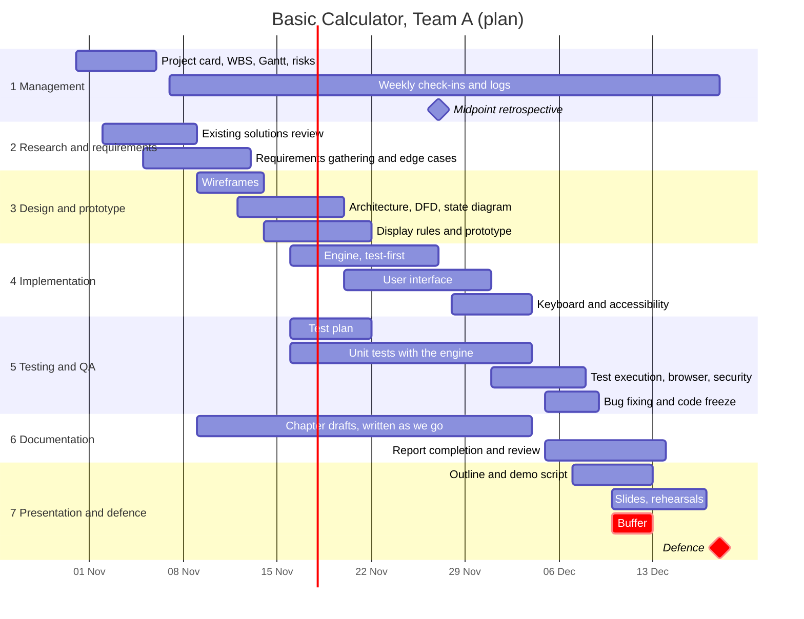

# Gantt Chart: 31 October - 18 December 2026

**Status:** Draft v0.1. This is a **plan**. Actual progress is recorded in the time log and weekly notes, not here.
**Last updated:** 2026-10-31

The project runs seven Saturday-to-Friday weeks. 31 October is a Saturday, 6 November, 27 November, 4 December and 18 December are Fridays.

Fixed dates from the professor's timetable (slide 11): project classes on **6 November** and **18 December 2026** (18:10-19:50). The 2 October class has already taken place.

## Chart (Mermaid)

## Milestones

| # | Date | Weekday | Milestone | Evidence expected when reached |
|---|---|---|---|---|
| M1 | 6 Nov | Friday | Project card and plan reviewed (class day) | Reviewed documents, notes |
| M2 | 13 Nov | Friday | Requirements baseline | Approved requirements specification |
| M3 | 20 Nov | Friday | Design and prototype review | Diagrams, wireframes |
| M4 | 27 Nov | Friday | First working version and team retrospective | Running build, retrospective notes |
| M5 | 4 Dec | Friday | Feature complete | Tests passing for Must items |
| M6 | 9 Dec | Wednesday | Code freeze and test report | Test report from real runs |
| M7 | 14 Dec | Monday | Documentation complete | Final report draft |
| M8 | 16 Dec | Wednesday | Dress rehearsal | Rehearsal notes |
| M9 | 18 Dec | Friday | Defence | Presentation and live demo |

## Weekly view

| Week | Dates | Mgmt | Research | Design | Build | Test | Docs | Present |
|---|---|---|---|---|---|---|---|---|
| W1 | 31 Oct - 6 Nov | ● | ○ | | | | | |
| W2 | 7 - 13 Nov | ○ | ● | ○ | | | ○ | |
| W3 | 14 - 20 Nov | ○ | | ● | ○ | ○ | ○ | |
| W4 | 21 - 27 Nov | ● retro | | ○ | ● | ○ | ○ | |
| W5 | 28 Nov - 4 Dec | ○ | | | ● | ● | ○ | |
| W6 | 5 - 11 Dec | ○ | | | fixes | ● | ● | ○ |
| W7 | 12 - 18 Dec | ○ | | | | | ● | ● |

● main effort, ○ light effort.

## Notes

- Playwright browser tests (WBS 5.4) are not shown as a separate bar. They depend on a later approval to install them and would sit inside "Test execution" in W5-W6.
- The buffer of 10-13 December is deliberate. If work slips, it is used first.
- Slide 13 shows a midpoint team retrospective in the PBL process. Its exact date is the team's choice; 27 November is our proposal.
- This schedule is a proposal. Dates change only through a recorded decision.
