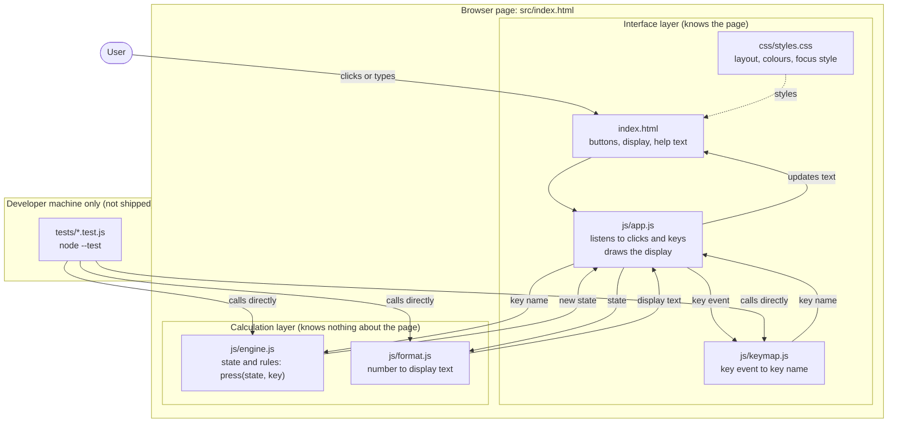
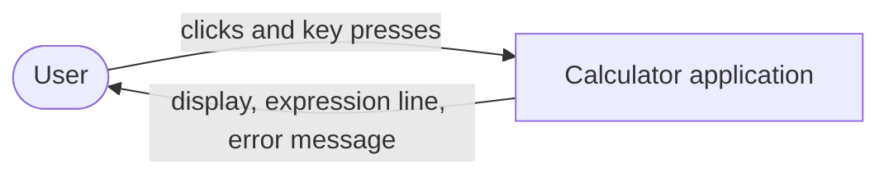
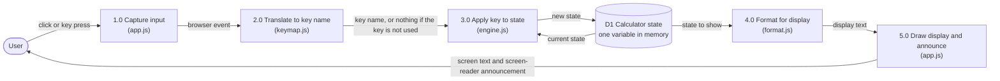
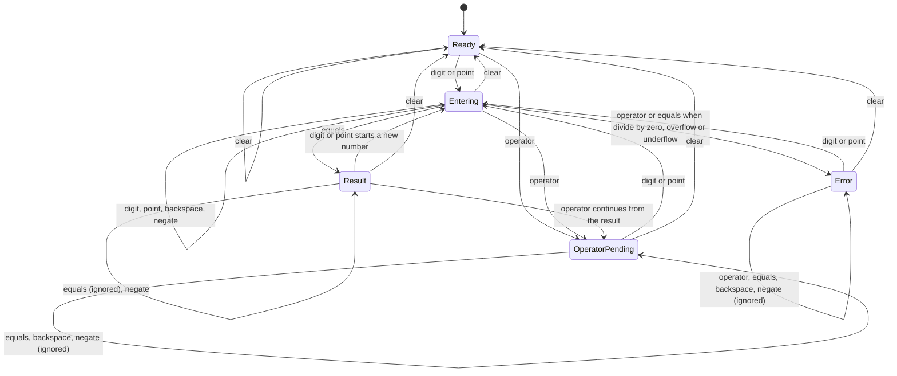

# Architecture and Diagrams

**Status:** Draft v0.2, finalised 2026-10-31 after the project lead's decisions (D9-D16). Percent is out of scope; the number policy of D3 is confirmed.
**Last updated:** 2026-10-31
**Skills used:** `engineering:system-design` (structure: requirements, high-level design, data flow, trade-offs). See [tool log](../00-admin/tool-ai-usage-log.md).
**How to view the diagrams:** The diagrams are written in Mermaid inside Markdown. GitHub, VS Code (with a Mermaid preview extension) and many Markdown viewers draw them. On 2026-10-31 all four diagrams were rendered with Mermaid in headless Microsoft Edge and every diagram parsed without errors (see the [tool log](../00-admin/tool-ai-usage-log.md), entry 19). A human should still look at them in the viewer the team uses.

## 1. Goal and constraints

Build a very simple, offline, trustworthy calculator in HTML, CSS and vanilla JavaScript (slide 8, slide 10; project card). Constraints that shape the design:

| Constraint | Source | Effect on the design |
|---|---|---|
| Opens by double-clicking `index.html`, no server, no build | NFR-07, D2 | Classic `<script>` tags, no ES modules, no npm packages at run time |
| Calculation must be testable without a browser | NFR-08, T-FR tests | The calculation logic has no knowledge of the page (no `document`, no `window`) |
| Five students, seven weeks | Project card | Few files, few concepts, easy to explain in a 10-minute defence |
| Correct results are the heart of the project | Driving question | Numbers and state rules are specified before code (sections 5 and 6) |

## 2. Application architecture

### 2.1 Diagram



### 2.2 Explanation (student level)

The calculator has **two layers**.

- The **interface layer** is everything the user can see or touch: the HTML (the buttons and the display), the CSS (colours, sizes, layout) and `app.js`. `app.js` is the "go-between". It listens for button clicks and key presses, turns each one into a simple *key name* such as `"7"`, `"+"` or `"="`, passes it to the calculation layer, and then writes the answer into the page.
- The **calculation layer** is two small files that do the thinking. `engine.js` holds the rules of the calculator: what happens when you press a key in a given situation. `format.js` turns a number into text for the display, for example `0.30000000000000004` into `0.3`.

**Why separate them?** (requirement NFR-08, and the professor's wish for a simple, well-structured project.) The calculation layer never touches the page, so we can test it from the command line with Node's built-in test runner, thousands of key sequences in a second, with no browser. If the interface changes (new colours, a different layout), the rules and their tests do not change. Two team members can also work at the same time on different layers without editing the same file.

The tests are not part of the product. They sit on the developer's computer and call `engine.js` and `format.js` directly.

### 2.3 File plan (proposed, to be built in Phase 3)

```
src/
├─ index.html
├─ css/styles.css
└─ js/
   ├─ engine.js     calculation layer: state, rules, arithmetic
   ├─ format.js     calculation layer: display text
   ├─ keymap.js     interface helper, pure: key event to key name
   └─ app.js        interface layer: events and rendering (the only file that touches the page)
tests/
├─ engine.test.js
├─ format.test.js
├─ keymap.test.js
└─ security.test.js
```

`engine.js`, `format.js` and `keymap.js` are classic scripts that attach one object each to the page (`CalcEngine`, `CalcFormat`, `CalcKeymap`). At the end of each file, a short check (`if (typeof module !== 'undefined') module.exports = ...`) lets Node load them in tests. This is the arrangement chosen in decision D2.

## 3. Modules and their interfaces (proposed)

| Module | Public functions | Rules |
|---|---|---|
| `CalcEngine` | `initialState()` returns a new state. `press(state, key)` returns the next state | **Pure:** it never changes the state it receives, never reads the clock, never uses randomness, never touches the page. Same input always gives the same output. This makes it easy to test |
| `CalcFormat` | `display(state)` returns `{ main, expression, error }` as text | Pure. Contains the number rules of section 6 |
| `CalcKeymap` | `commandForKey(keyEvent)` returns a key name or `null` | Pure. Implements the keyboard map (section 5 of [ui-design.md](ui-design.md)). Ignores keys with Ctrl, Alt or Meta |
| `app.js` | none (it runs on page load) | Holds one variable with the current state, connects buttons and keys to the engine, and writes the text into the page |

**Key names the engine understands** (the *vocabulary* shared by buttons, the keyboard and the tests): `0`-`9`, `.`, `+`, `-`, `*`, `/`, `=`, `CLEAR`, `BACKSPACE`, `NEGATE`. Any other key name is ignored.

**State (what the engine remembers)**

| Field | Meaning | Example |
|---|---|---|
| `phase` | Which state of the state diagram we are in (`ready`, `entering`, `operatorPending`, `result`, `error`) | `entering` |
| `entry` | The digits being typed, as text, so `0.` and `1.50` are kept exactly | `"12.5"` |
| `accumulator` | The stored left-hand number (a JavaScript number), or `null` | `7` |
| `operator` | The pending operator or `null` | `"+"` |
| `error` | `null`, `"DIV_ZERO"`, `"OVERFLOW"` or `"UNDERFLOW"` | `null` |

In the Error state the engine keeps the left number, the operator and the right number that caused the error, so that the display can still show the failed calculation (for example `5 ÷ 0`). A digit or Clear discards them.

Operations in the engine: add, subtract, multiply, divide, negate, backspace, clear. There is no percent (decision D10). There is no `eval`, no `Function`, and no expression parser, because the calculator only ever combines two numbers at a time (D1).

## 4. Data-flow diagram

### 4.1 Level 0 (context)



### 4.2 Level 1 (what happens inside)



### 4.3 Explanation (student level)

A data-flow diagram shows **how information moves**, not the order of code. Circles or boxes are *processes* (things that change data), the open box with two lines is a *data store* (a place where data waits), and arrows are *data*.

1. **1.0 Capture input.** The user clicks a button or presses a key. The browser creates an *event*.
2. **2.0 Translate to key name.** `keymap.js` turns the event into one of our key names, for example the physical `Enter` key becomes `=`. Keys we do not use (such as `F5`, or `Ctrl+C`) produce *nothing* and are left to the browser. This keeps the browser's own shortcuts working.
3. **3.0 Apply key to state.** The engine reads the current state from **D1**, applies the rules for that key and writes the new state back. This is the only place where calculator behaviour is decided.
4. **4.0 Format for display.** The formatter turns the state into text: the big number, the small line that shows the pending operation (for example `7 +`), and an error message if there is one.
5. **5.0 Draw display and announce.** `app.js` writes the text into the page. Because the display is a *live region*, a screen reader reads the change aloud.

The state **D1** is never saved to disk or sent anywhere: it lives in memory, and reloading the page resets the calculator. This is why the application collects no personal data (NFR-09).

## 5. State diagram

### 5.1 Diagram



### 5.2 Explanation (student level)

A state diagram shows the **situations the calculator can be in** (the boxes) and **which key moves it to which situation** (the arrows). A calculator needs this because the same key means different things in different situations: `-` after `5` is "subtract", but `-` at the very start could be a minus sign, and after an error it must do nothing.

| State | What it means | Display shows |
|---|---|---|
| **Ready** | Just started or cleared | `0` |
| **Entering** | The user is typing a number | The digits typed so far |
| **OperatorPending** | An operator was pressed and the calculator waits for the second number | The left-hand number; the small line shows `7 +` |
| **Result** | A result is on screen after `=` | The result |
| **Error** | Division by zero, overflow or underflow | `Error`, with a message line such as `Cannot divide by zero` |

The most important rules (every one becomes at least one automated test):

- **Immediate execution (D1, FR-05).** In *Entering* with an operator already pending, pressing a new operator first calculates the pending operation, then waits for the next number. So `2 + 3 ×` shows `5` and then `4 =` gives `20`.
- **Second operator replaces the first (FR-08).** In *OperatorPending*, `5 + ×` becomes `5 ×`.
- **After a result (FR-04).** A digit starts a new calculation. An operator continues with the result.
- **Equals with nothing to do is safe (FR-18).** Pressing `=` in *Ready*, *OperatorPending* or after a result changes nothing. Repeat-equals (pressing `=` again to repeat the last operation) is **not** supported (decision D11).
- **Errors recover (FR-09).** In *Error* only a digit, a point or Clear is accepted. A digit starts a fresh number.
- **12-digit limit (FR-12).** In *Entering*, a 13th digit is ignored.
- **One decimal point per number (FR-02, lesson L5).** Starting a new number resets the check.
- **Zero stays zero (FR-15).** Negate on a zero entry (`0`, `0.`, `0.0`) does nothing.
- **Too big or too small (FR-11).** A result that is infinite shows `Number too large`. A product or quotient of two non-zero numbers that becomes `0` shows `Number too small`. Both go to the Error state.

**Full transition table** (rows are states, columns are key groups). "Ignored" means the state is unchanged.

| State | Digit | Point | Operator | Equals | Backspace | Negate | Clear |
|---|---|---|---|---|---|---|---|
| Ready | Entering (entry = digit) | Entering (`0.`) | OperatorPending (left = 0) | Ignored | Ignored | Ignored | Ready |
| Entering, no operator pending | Append (limit 12; replaces a lone `0`) | Add `.` if none | OperatorPending (left = entry) | Result (value = entry) | Remove last character; empty gives `0` | Toggle sign (a zero stays `0`) | Ready |
| Entering, operator pending | Same | Same | Calculate, then OperatorPending or Error | Calculate, then Result or Error | Same | Same | Ready |
| OperatorPending | Entering (new entry) | Entering (`0.`) | Replace operator | Ignored | Ignored | Ignored | Ready |
| Result | Entering (result discarded) | Entering (`0.`) | OperatorPending (left = result) | Ignored | Ignored | Negate result | Ready |
| Error | Entering (fresh) | Entering (`0.`) | Ignored | Ignored | Ignored | Ignored | Ready |

**Open design details (not yet decided):** whether a leading minus can be typed at the start of a number (current design: only with the negate key); and exactly how many characters the display can hold before the text must shrink (to be measured in Phase 3, since it depends on font and width).

## 6. Number policy (rounding and display)

**Decision (2026-10-31): option A is adopted** (D3 confirmed, D9 rejected). The engine preserves the numeric result. The comparison below is kept as the record of the alternatives considered and as report material.

### 6.1 The problem

Computers store most decimal fractions approximately. A scratch calculation with Node on 2026-10-31 (not project code, reproducible by anyone with `node`) gave these raw JavaScript results:

| Expression | Raw result |
|---|---|
| `0.1 + 0.2` | `0.30000000000000004` |
| `0.3 - 0.1` | `0.19999999999999998` |
| `1.1 * 3` | `3.3000000000000003` |
| `0.7 + 0.1` | `0.7999999999999999` |
| `1 / 0` | `Infinity` |

(Why this happens is a general property of binary floating-point numbers. A citable source such as the ECMAScript specification or MDN has **not** been read by us yet; add one before the report states the cause.)

### 6.2 Display formatting (proposed, same for all options)

1. If the value is not a finite number, it must never reach the display: the engine reports `DIV_ZERO` or `OVERFLOW` instead.
2. Show at most **12 significant digits**; remove trailing zeros. In Node, `Number.prototype.toPrecision(12)` followed by trimming gave `0.3` for `0.30000000000000004` and `0.333333333333` for `1/3`.
3. Use fixed notation when `0.0001 <= |value| < 1e12`; otherwise exponential notation such as `9.99999999998e+23` or `1e-13`. These two thresholds are tunable (see open question O3).
4. `-0` is shown as `0`.
5. A non-zero value is never shown as `0` (rule 5 of the requirements specification section 4).

Checked in the scratch calculation: `999999999999 × 999999999999` gives `9.99999999998e+23`, and `1e-12 ÷ 10` gives `1e-13`. (Note: with the 12-digit entry limit, `0.000000000001` cannot be typed; the tests use `0.00000000001 ÷ 10 = 1e-12`.)

### 6.3 Options for what the engine *stores*

| Option | Idea | Result of `0.1+0.2-0.3` | Result of `(1÷3)×3-1` | Complexity | Verdict |
|---|---|---|---|---|---|
| **A. Store the raw result** (D3, **adopted**) | Never change the stored number | `5.55111512313e-17` (documented behaviour) | `0` ✓ | None | **Adopted by the project lead, 2026-10-31.** Honest, simple. The `0.1+0.2-0.3` display is explained in the user guide and tested |
| **B. Normalise to 15 significant digits after every operation** | Store `Number(result.toPrecision(15))` | `0` ✓ | `-9.99200722162641e-16` ✗ (displayed as `-9.99200722162e-16`) | Low | Not adopted: fixes one case and breaks another |
| **D. Raw numbers, plus "snap to zero" for add and subtract** (D9) | If `|a+b| <= 1e-15 × max(|a|,|b|)`, the result is `0`; otherwise unchanged | `0` ✓ | `0` ✓ | Low (about 3 lines) | **Rejected by the project lead, 2026-10-31** (D9): results are preserved, nothing is snapped |
| **E. Exact decimal arithmetic for `+ - ×` using `BigInt`** | Treat typed numbers as scaled integers | `0` ✓ | `0` ✓ for `+ - ×`; division still approximate | High (more code, more tests) | Not recommended for "very simple"; could be a stretch goal |
| **F. External decimal library** | Use a library | ✓ | ✓ | Dependency | Rejected: conflicts with offline, no-dependency rule |

Results above come from three scratch calculations run in Node on 2026-10-31. They are **evidence for the decision, not test results**: no test has been written or run for the project.

**Why D was proposed (rejected, kept for the record).** The snap rule removes only a result that is tiny *compared with the numbers that produced it*, which is almost surely rounding residue, and it leaves every other value untouched. In the scratch run, option D gave `0` for `0.1+0.2-0.3`, `(1÷3)×3-1`, `10÷3×3-10`, `0.1×3-0.3`, `0.7+0.1-0.8` and `1.1×3-3.3`, and kept `1e-20 + 2e-20` non-zero.

**Known limit of every option.** `1 - 0.9999999999` gave `1.000000082740371e-10` in the scratch run, although the true answer is `1e-10`. Subtracting two almost-equal numbers magnifies the small storage error of the inputs. Option D does not fix this and neither does B. Only option E would. Under the adopted option A this is a **known limitation** to document in the user guide and the test report.

**Need for tests.** The risk RK-05 stays open. Phase 3 must include the cases above plus a randomised test that no key sequence produces `NaN`, `Infinity` or `undefined` (NFR-02).

## 7. Security and robustness notes

(Proportionate to a small offline page; supports NFR-06, professor's slide 5 "security analyses", open question Q9.)

| Topic | Design decision |
|---|---|
| Code execution | No `eval`, no `new Function`, no `setTimeout("string")`. Arithmetic is done by four small functions |
| Page injection | The display is written with `textContent`, never `innerHTML` |
| Third-party code | None. No CDN, no web fonts (system font stack), no analytics. Everything works offline |
| Content Security Policy | A `<meta http-equiv="Content-Security-Policy">` is planned that allows only the page's own scripts and styles. **Not yet tested from `file://`:** browsers treat `file:` pages specially, so the exact policy must be tried in Chrome, Firefox and Edge during Phase 3. Do not assume it works |
| Personal data | None collected, stored or sent. No cookies, no `localStorage` (history is out of scope, W-03) |
| Input | Only our own key names are accepted; any other event is dropped at step 2.0 of the data-flow diagram |

## 8. Alternatives considered

| # | Decision | Chosen | Alternatives | Why chosen |
|---|---|---|---|---|
| 1 | Evaluation model | Immediate execution (D1) | Operator precedence with an expression parser | Windows Standard mode and the open-source example do the same ([review](../02-research-requirements/calculator-review.md) L1). Simpler state machine |
| 2 | Calculation model | State machine over key presses | Build a text expression (`"2+3*4"`) and evaluate it at `=` | Avoids `eval` or a parser (security, simplicity). Every key has a defined effect, so every situation is testable |
| 3 | Code structure | Pure engine + formatter + UI glue | One script mixing logic and DOM; or a framework (React, Vue) | Testable without a browser; no build step; fewer concepts for five students. A framework would add dependencies and conflict with offline use |
| 4 | Loading | Classic scripts (D2) | ES modules | Modules fail from `file://` in some browsers, which risks the live demo |
| 5 | State representation | One plain object, replaced on each key | Several global variables mutated everywhere (typical beginner style) | The old state is never changed, so tests are simple and bugs are easier to find |
| 6 | Number entry | Keep the typed text (`entry`) | Keep a number while typing | Text preserves `0.`, `1.50` and the 12-digit limit exactly |
| 7 | Diagrams | Data-flow + state (D4) | Class diagram | The code has few objects; behaviour is the hard part |
| 8 | Storage | None | `localStorage` history | Out of scope; avoids privacy and test work |

## 9. What we would revisit if the project grew

- Operator precedence and brackets would need a parser (a different architecture).
- A history list would need storage and privacy rules.
- If exact decimals mattered (money), option E or a library would become necessary.

## 10. Open questions and their answers

| # | Question | Answer |
|---|---|---|
| O1 | Approve D9 (snap to zero)? | **No.** D9 rejected, D3 confirmed (2026-10-31) |
| O2 | Approve D10 (percent = ÷ 100) or drop percent? | **Dropped.** Percent is out of scope (W-08) |
| O3 | Are the display thresholds (12 significant digits; fixed notation between `0.0001` and `1e12`) acceptable? | The project lead asked for a clearly documented formatting policy with dedicated tests. The thresholds are implemented as stated in 6.2 and covered by `tests/format.test.js`. Open for team review |
| O4 | Approve D11 (no repeat-equals)? | **Yes** |
| O5 | Does the professor expect a particular diagram notation (UML, Yourdon)? | **Still open** (Q2). Slide 32 names "data flow diagrams" but gives no notation |
| O6 | Does a `meta` Content Security Policy work from `file://` in all three browsers? | **Open.** Phase 3 tests it in Edge only; Chrome and Firefox remain untested |
